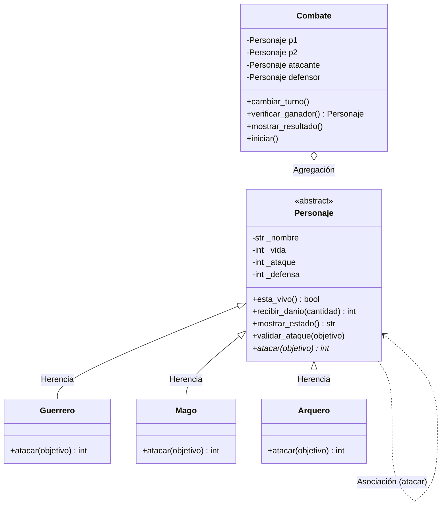

# 🛡️ Guardians of the Ancient Kingdom

## 1. Descripción
**Guardians of the Ancient Kingdom** es un sistema de combate por turnos desarrollado en Python. El proyecto resuelve el desafío de administrar reglas de negocio estrictas (cálculos de daño únicos por clase, validaciones de atributos, control de rondas) aplicando los pilares fundamentales de la Programación Orientada a Objetos (POO). El resultado es un código modular, fácilmente escalable y resistente a datos corruptos.

---

## 2. Estructura del Proyecto
El repositorio consta de los siguientes archivos:
*   `personajes.py`: Motor del sistema. Contiene las definiciones de las clases, atributos, encapsulamiento, métodos matemáticos y validaciones.
*   `main.py`: Archivo principal de ejecución. Su propósito es instanciar los objetos y ejecutar de manera secuencial los 12 casos de prueba obligatorios requeridos.
*   `test_personaje.py`: Archivo dedicado a las pruebas unitarias automatizadas (Reto Pytest).
*   `README.md`: Documentación técnica del diseño del software.

---

## 3. Responsabilidad de las Clases
*   **`Personaje` (Abstracta):** Plantilla base. Su responsabilidad es resguardar el estado general (nombre, vida, ataque, defensa) asegurando, mediante validaciones, que no existan atributos incongruentes (ej. vida negativa).
*   **`Guerrero`, `Mago`, `Arquero`:** Clases concretas. Su única responsabilidad es definir su forma específica de infligir daño implementando sus propias fórmulas matemáticas (habilidades).
*   **`Combate`:** Clase administradora. Su responsabilidad es orquestar la pelea: controla los turnos, aplica el daño entre los contendientes, evalúa si alguien llegó a 0 puntos de vida, y declara empates si se superan las 50 rondas sin daño.

---

## 4. Relaciones entre Clases
*   **Herencia:** `Guerrero`, `Mago` y `Arquero` heredan de `Personaje` para reutilizar atributos (vida, ataque) y métodos base (recibir daño), evitando la duplicación de código.
*   **Asociación:** Se evidencia en el método `atacar(objetivo)`, donde un objeto `Personaje` interactúa con otro objeto `Personaje` de forma temporal para calcular y aplicar una reducción de vida.
*   **Agregación:** `Combate` *tiene* participantes (`self.p1`, `self.p2`). Los personajes existen independientemente de que haya o no un combate en curso.

---

## 5. Conceptos de POO Aplicados
*   **Abstracción:** Uso de `ABC` y `@abstractmethod` en `Personaje` para crear un "molde" conceptual del cual no se pueden instanciar objetos directos.
*   **Encapsulamiento:** Atributos protegidos modificables únicamente a través de decoradores `@property` y `@setter`.
*   **Polimorfismo:** En el método `iniciar()` de `Combate`, la línea `self.atacante.atacar(self.defensor)` invoca la versión correcta del ataque sin usar condicionales `if/else`, confiando en la forma de la subclase correspondiente.

---

## 6. Lógica del Combate
El combate se desarrolla en un ciclo cerrado controlado por `Combate`. 
El cálculo de daño funciona en dos fases:
1.  **Ataque:** El atacante calcula un daño bruto basado en su clase (ej. Guerrero suma +20%, Mago ignora defensa).
2.  **Recepción:** El objetivo ejecuta `recibir_danio()`, utilizando la función `min()` para descontar el impacto asegurando que su HP nunca caiga por debajo de cero.
3.  **Turnos:** Se alternan los roles mediante `cambiar_turno()`. Si una ronda entera transcurre sin daño, se declara empate técnico.

---

## 7. Ejecución
Para visualizar el proyecto en consola, simplemente clona el repositorio, abre una terminal en la carpeta principal y ejecuta:
```bash
python main.py
```

---

## 8. Pruebas y Resultados
Al ejecutar `main.py`, el sistema arroja los resultados de 12 validaciones estrictas:
*   **Creación y Excepciones:** Se comprueba el rechazo exitoso de vida negativa, nombres vacíos y ataques nulos (`ValueError`).
*   **Matemáticas de Daño:** Confirmación de multiplicadores (Ej. Ataque de Arquero de 35 vs Defensa de 15 resulta en 40 puntos exactos de daño).
*   **Lógica de Estado:** Rechazo a acciones inválidas como atacar a un enemigo ya derrotado o atacar estando muerto.
*   **Simulación Práctica:** Combate completo de 6 turnos entre Arthas y Gandalf, resultando en la supervivencia y victoria automática de Gandalf.

---

## 🏆 Retos Adicionales Completados

### Reto 1: Diagrama de Clases UML
El siguiente esquema representa la arquitectura del sistema. `Personaje` es la clase base con el método abstracto `atacar()`, del cual derivan las tres subclases. A la derecha, `Combate` actúa como administrador externo.



### Reto 2: Pruebas Automatizadas con Pytest
El sistema cuenta con un archivo externo (`test_personaje.py`) que evalúa las reglas de negocio de manera aislada utilizando el framework Pytest.
**Ejecución:**
```bash
pytest test_personaje.py
```
**Resultado:**
```text
collected 6 items
test_personaje.py ......                                            [100%]
=========================== 6 passed in 0.06s ===========================
```
*Se validaron daños específicos, manejo de excepciones (raises ValueError) y límites de vida.*

### Reto 3: Desafío de Abstracción
**¿Por qué `atacar()` debe ser abstracto, pero `recibir_danio()` se implementa en la clase base?**

*   **Comportamiento Variable (`atacar()`):** Se define como abstracto porque el *cómo* infligir el daño es la firma única de cada guardián. Un Mago no usa la misma mecánica que un Arquero. Al ser abstracto, forzamos a cada orden a programar sus propias reglas, garantizando así el **polimorfismo** seguro al nivel del gestor de combate.
*   **Comportamiento Universal (`recibir_danio()`):** A diferencia de atacar, todos los entes biológicos del sistema pierden vida de la misma manera: matemáticamente sufren una resta en su HP que no puede bajar de cero. Implementarlo en la clase principal fomenta la **reutilización de código**, evitando sobreescribir la misma matemática tres veces distintas. La clase hija decide *cuánto* daño hace, pero la clase padre siempre decide *cómo* el cuerpo lo soporta.